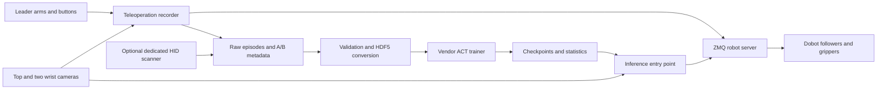

# Learned Mail and Parcel Sorting

RSE4018 capstone project by **Muhammad Adiel Firqin Bin Muhamad Subta**, built on Dobot X-Trainer and its supplied parallel-jaw grippers.

## Problem and motivation

Thin envelopes, compliant poly mailers, and rigid cartons require different contact and grasping strategies. This project investigates whether human demonstrations can teach these strategies on the same general-purpose hardware without changing the supplied fingertips. The planned evaluation compares ACT and Diffusion Policy, specialist and shared acquisition policies, and performance at different demonstration counts. The scope follows the capstone proposal dated 14 September 2026, retained locally.

**Policy A** acquires an item, presents it at the reading station, stages it, and retracts. **Policy B** reacquires it and places it in the destination bin. Staging provides an observable starting state and makes the destination available before B begins.

## Current architecture



Recording, A/B metadata, conversion, and separate ACT task training are implemented. The poly-mailer baseline uses A, B bin 0, and B bin 1. Destination labels are preserved, but the vendor ACT loader does not consume them. A shared destination-conditioned B model, automatic A/B handoff, and the Diffusion Policy comparison remain future work. Bundled diffusion code is not a tested parcel-sorting pipeline. Existing inference commands both arms.

## File structure and ownership

| Path | Purpose and provenance |
| --- | --- |
| [experiments/](experiments/README.md) | Adapted Dobot server, recorder and inference entry points; custom configuration and terminal homing |
| [scripts/](scripts/README.md) | Adapted Dobot setup/conversion helpers; custom counting, validation and configuration |
| `barcode_scanning/` | Capstone additions: labels, HID reader, A/B metadata and destination preservation |
| `dobot_control/`, `ModelTrain/` | Dobot-supplied hardware interfaces and ACT integration; task registration adapted locally |
| `robomimic-r2d2/`, `third_party/` | Bundled upstream libraries and device SDKs |
| `docs/guides/`, `tests/` | Capstone operating guides and hardware-free checks |
| `datasets/`, `ckpt/` | Local data and trained models, excluded from Git |

Capstone additions and adaptations are work developed for Adiel Firqin's project. The supplied SDK and learning algorithms retain their upstream authorship and licenses. "Adapted" identifies a modified Dobot file rather than a wholly original implementation.

## Record demonstrations

Use the existing **Python 3.8 Xtrainer environment**. Vendor training modules are distributed as Python 3.8 bytecode; `requirements.txt` is not a complete environment lockfile. On a fresh checkout, copy `scripts/dobot_config/dobot_settings.example.ini` to the local `dobot_settings.ini` only if absent, then configure devices and calibrate. The example is a schema, not working calibration.

```bash
conda activate Xtrainer
cd /path/to/capstone-project-parcel-sorting
# Terminal 1: start one server
python3 experiments/launch_nodes.py
```

In terminal 2, activate the same environment and start one recorder:

```bash
python3 experiments/run_control.py --show-img \
  --project-name second_set_poly_mailer_A \
  --policy-stage A --medium poly_mailer --no-capture-barcode
```

For B, use its own project name, `--policy-stage B`, and `--demonstrated-bin 0` or `1`. Support the leader; short yellow A presses below 0.5 seconds toggle torque lock. Hold yellow A above 1 second and release to toggle synchronization, then wait for alignment. Press/release green B to start; repeat to stop. At least one arm must be synchronized. Finish recording and disable synchronization before exiting. Episodes save in `datasets/<project>/collect_data/<timestamp>/`.

Server startup enables hardware and cycles grippers; recorder startup moves both followers. Keep startup paths clear. Recording controls are not emergency stops. See the [recording guide](docs/guides/barcode_recording_guide.md).

## Prepare and train ACT

Add actual project names to `PREPARE_ACT_DATASETS["projects"]` in [scripts/scripts_config.py](scripts/scripts_config.py). The defaults register three first-set projects. Copy those entries for a second set, preserving A/None, B/0 and B/1. `ModelTrain/constants.py` registers the configured names as training tasks automatically.

```bash
python3 scripts/count_episodes.py
python3 scripts/prepare_act_datasets.py --dataset-name second_set_poly_mailer_A
python3 scripts/prepare_act_datasets.py --dataset-name second_set_poly_mailer_A --convert

python3 -c "import torch; print(torch.cuda.is_available())"
# Train when CUDA reports True; use a fresh checkpoint folder.
PYTHONPATH=. MPLBACKEND=Agg python3 ModelTrain/model_train.py \
  --task_name second_set_poly_mailer_A \
  --ckpt_dir ./ckpt/act_second_set_poly_mailer_A \
  --batch_size 8 --num_steps 30000 --lr 2e-5 \
  --chunk_size 45 --kl_weight 10 --seed 0
```

Repeat with each B task and a separate output folder. Review demonstration videos before training. `--dataset-name` is optional: without it all configured projects are selected. Conversion refuses existing HDF5 outputs; already converted projects need validation only. Defaults are a 400-step horizon, an 80/20 episode split, and three cameras.

`--ckpt_dir` determines where models go. Keep `config.pkl` and `dataset_stats.pkl` with the checkpoints. See the [ACT guide](docs/guides/act_poly_mailer_training.md) and [scripts README](scripts/README.md), including how to train both collection sets together.

## Versions and history

| Component | Recorded information | Status |
| --- | --- | --- |
| Capstone software | Unreleased development snapshot; documentation prepared 12 October 2026 | Release number to be assigned |
| Lightweight-base user guide | Front page: V1.1, 31 July 2024 | Applicable guide to be confirmed |
| Operation/startup guide and FAQ | No version identified in opening pages | To be confirmed |
| Dobot SDK | `version.txt` names v1.0.7 and later dated changes | Installed release to be confirmed separately from guide versions |
| Bundled robomimic | Source reports 0.3.0 | Upstream variant/revision to be confirmed |

Development milestones include scanner/A-B metadata integration, non-destructive conversion, episode counting/validation, shared configuration, and separate ACT task registration. These are not numbered releases. Preserve the original [vendor history](version.txt); platform manuals and the proposal remain local reference documents.

## Citations and licenses

- Zhao, T. Z., Kumar, V., Levine, S., and Finn, C. (2023). **Learning Fine-Grained Bimanual Manipulation with Low-Cost Hardware** (ACT). [Paper](https://arxiv.org/abs/2304.13705) · [Code](https://github.com/tonyzhaozh/act).
- Chi, C., et al. (2023; revised 2024). **Diffusion Policy: Visuomotor Policy Learning via Action Diffusion**. [Paper](https://arxiv.org/abs/2303.04137) · [Code](https://github.com/real-stanford/diffusion_policy).
- Underlying platform software: Dobot. See [LICENSE](LICENSE), [THIRD-PARTY-LICENSES](THIRD-PARTY-LICENSES), and bundled component licenses for retained attribution.
